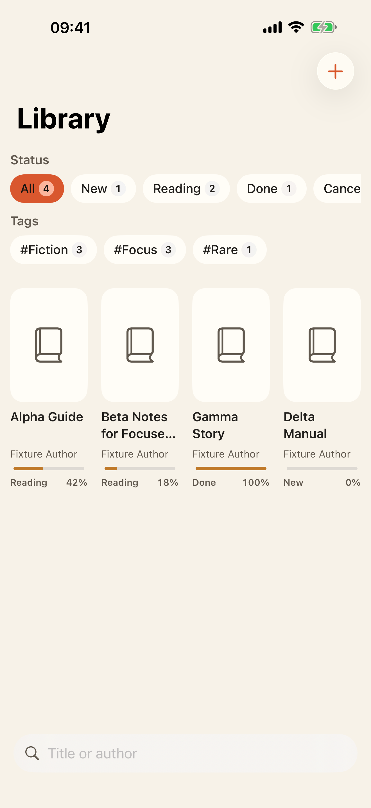
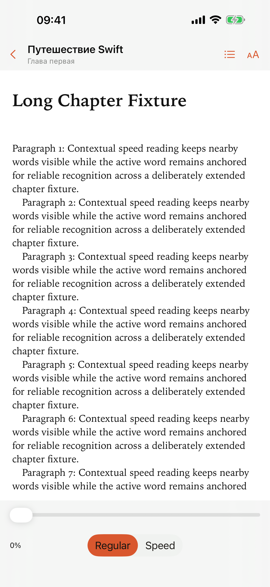
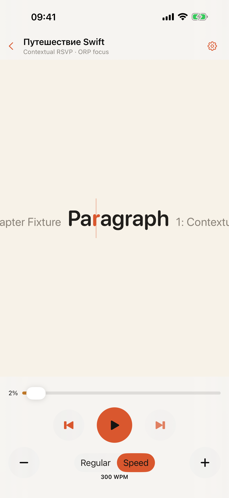

# SpeedRead

[App Store](https://apps.apple.com/app/id6792124935) ·
[Support](https://sild.github.io/speedread/support.html) ·
[Privacy](https://sild.github.io/speedread/privacy.html) ·
[Apache-2.0](../LICENSE)

SpeedRead is a private, local-first EPUB and PDF reader for iPhone and iPad.
It combines a conventional Readium-powered reader with a contextual RSVP mode
that keeps nearby words visible while anchoring the active word.

<p>
  
  
  
</p>

## Highlights

- DRM-free EPUB 2/3 and password-free PDF import
- customizable regular reading powered by Readium
- contextual speed reading from 100 to 1000 WPM
- on-device PDF text extraction and Vision OCR
- offline library, progress, status, tags, search, and sharing
- optional private iCloud synchronization with SpeedRead Pro
- no advertising, analytics, tracking, custom account, or custom backend

Free access includes the complete local feature set for up to three books.
SpeedRead Pro adds an unlimited library and private iCloud synchronization.
Existing books remain readable if Pro access ends.

## Privacy

Reading and OCR happen on-device. SpeedRead does not operate a custom backend.
When Pro iCloud sync is enabled, original books and library state use the
person's private CloudKit database. Derived PDF text and OCR data stay local.
See the full [privacy policy](../docs/privacy.html).

## Requirements

- macOS with Xcode 26.6
- iOS/iPadOS 17 or newer
- an installed iOS simulator runtime
- network access for the initial pinned-tool and Swift package download

An Apple Developer account is required only for signed physical-device builds,
CloudKit administration, or App Store distribution.

## Development

Bootstrap the pinned XcodeGen, SwiftFormat, and SwiftLint versions:

```sh
make bootstrap
make generate
```

Use the smallest validation target that covers a change:

```sh
make logic-test
make test-one TEST=SpeedReadTests/DomainIntegrationTests/libraryStatusToggle
make ui-test UI_TEST=testImportAndOpenRegularReader
```

Before opening a pull request:

```sh
make format-check
make lint
make test
make project-check
```

`project.yml` is the Xcode project source of truth. Regenerating
`SpeedRead.xcodeproj` must produce no diff.

Additional commands and validation boundaries are documented in
[Testing](docs/TESTING.md) and [Release](docs/RELEASE.md).

## Architecture

SpeedRead targets iOS/iPadOS 17+ with Swift 6 strict concurrency and SwiftUI.
Readium types stay behind the publication adapter, serialized Readium locators
are canonical reading positions, and book/file access goes through explicit
repository boundaries.

See:

- [Product specification](docs/PRODUCT.md)
- [Architecture](docs/ARCHITECTURE.md)
- [Design system](docs/DESIGN.md)
- [Roadmap](ROADMAP.md)

## Format support

| Format | Behavior |
| --- | --- |
| DRM-free EPUB 2/3, reflowable | Regular and speed reading when textual content is extractable |
| DRM-free EPUB 3, fixed layout | Regular reading; speed reading when textual content is extractable |
| DRM-free, password-free PDF with embedded prose | Native regular reading and local speed extraction |
| Image-only PDF with reliable Latin/Cyrillic prose | Native regular reading and on-device OCR speed mode |
| Copy-restricted PDF | Regular reading; speed mode unavailable |
| Protected EPUB or password-locked PDF | Rejected with an actionable explanation |

## Contributing and security

Contributions are welcome. Read [CONTRIBUTING.md](../CONTRIBUTING.md) before
opening a pull request.

Please report vulnerabilities privately using [SECURITY.md](../SECURITY.md), not a
public issue.

## License

SpeedRead is licensed under the [Apache License 2.0](../LICENSE). Third-party
components remain under their respective licenses; see
[THIRD_PARTY_NOTICES.md](THIRD_PARTY_NOTICES.md).
